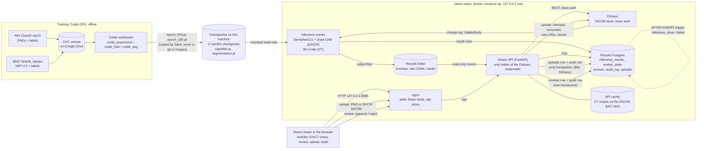

**For education only. Not for clinical use.**

# Architecture

How data, models and studies move through the project. Arrows show the direction data flows.

## The parts

- **Training (offline).** The data is versioned with DVC; the remote is a Google Drive folder.
  The Colab notebooks preprocess the NIH images, train the DenseNet121 classifier and the MONAI
  3D U-Net on a GPU, and write the checkpoints and metrics (`reports/`). Training is not part of
  the running stack and cannot be run from it. The checkpoints are copied by hand to
  `C:\aiml02-checkpoints\` and mounted read-only into the worker; they are never in git or in an
  image.
- **Orthanc** stores the DICOM studies. Its REST API needs a password, and its ports are bound
  to 127.0.0.1. A study becomes `StableStudy` 5 s after its last instance arrives.
- **Inference worker** (`src/service/worker.py`) follows Orthanc's change log. For each new
  stable study it runs the classifier with Grad-CAM on DX/CR series and the U-Net on CT series,
  writes the output files to the results folder and one row per (study, checkpoint) to the
  results database. It keeps its place in the change log, so a restart resumes.
- **Results database** (Postgres, `migrations/`): `inference_results` and `worker_state` (the
  worker's), `reviews`, `audit_log` and `uploads` (the viewer's). `reviews` and `audit_log` are
  append-only: triggers refuse UPDATE, DELETE and TRUNCATE. A trigger on `inference_results` adds
  an `inference_done` or `inference_failed` audit row in the same transaction as each result.
- **Viewer API** (`src/api/`, FastAPI) is the only part that holds the Orthanc credentials. It
  reads Orthanc, the results database and the results folder (mounted read-only), and writes
  only reviews, uploads and their audit rows. Its one writable folder is the CT mask cache.
  Endpoints: [api.md](api.md).
- **nginx** (frontend container) serves the React build and proxies `/api` to the API, so the
  browser talks to one origin and never to Orthanc.
- **React viewer** (`frontend/`): worklist, DX view (image, Grad-CAM overlay, scores), CT view
  (slices, spleen mask), review panel, upload page and audit log.

## Two paths in detail

- **Upload:** browser -> nginx -> API. The API checks the file by its content (PNG, or DX/CR
  DICOM marked de-identified; at most 20 MB), gives it new UIDs and stores it in Orthanc. Only
  after Orthanc accepted it does the API write the `uploads` row and its `upload` audit row, in
  one transaction. The worker then picks the new study up from the change log like any other.
- **Review:** browser -> nginx -> API. The API checks that the reviewed result is the study's
  newest and that the submit token is new, then writes the `reviews` row and its `review` audit
  row in one transaction. The newest review is the study's current state.
