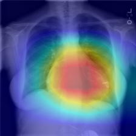
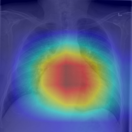
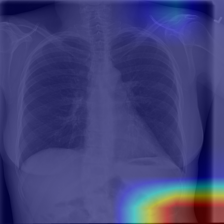
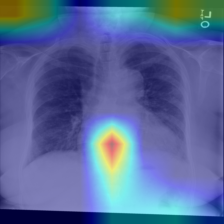
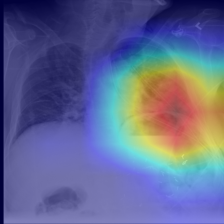
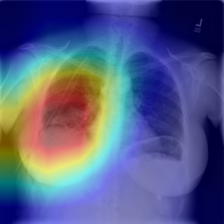

# Grad-CAM demo

**For education only, not for clinical use.** A Grad-CAM map shows which regions raised the
model's score for one label. It does not show where the finding is, and it is not a check that
the model is right.

- Model: DenseNet121, checkpoint `epoch_003.pt` (the best val epoch), run on CPU.
- Target layer: the last dense block (`features.denseblock4`).
- Preprocessing: the evaluation path (`resize_png`, then the test-split transform).
- Command: `python -m src.explain.gradcam --checkpoint epoch_003.pt --image <png> --label <label>
  --out-dir docs/figures/gradcam`.
- Each overlay is the 224px image the model saw: red is the highest Grad-CAM value and blue the
  lowest. Each JSON next to it holds the score, and the threshold and reliability from
  `configs/viewer_thresholds.yaml`.
- Sides are the patient's: the patient's right is on the left of the image.

## How the images were chosen

Both rules were fixed before the model was run on those images, so the choice does not depend on
the scores. All images come from the NIH ChestX-ray14 **test** split. For each finding, the
eligible images are:

- PA view
- the finding is the image's only label
- sorted by image name

**Set 1** takes the first two eligible images per finding, from different patients.

**Set 2** takes the next two after set 1 in the same list, under two conditions: no patient from
set 1, and each patient used once across set 2. Findings are processed in the order
Cardiomegaly, Effusion, Pneumothorax.

Set 1 has 4 patients (patient 13 three times); set 2 has 6 other patients. The PNGs were
downloaded one at a time with `kaggle datasets download nih-chest-xrays/data -f <path>` into
`data/raw/demo/` (gitignored). Labels are NLP-mined from reports, not verified by a radiologist.

## Results

Scores are model outputs, not calibrated probabilities. All three labels use set B thresholds
(val sensitivity >= 0.80); none is flagged low reliability.

| set | image | label | score | threshold | above | where the map sits |
|---|---|---|---|---|---|---|
| 1 | 00000013_045 | Cardiomegaly | 0.221 | 0.0248 | yes | over the heart; a pacemaker is in the left upper chest, outside the hottest region |
| 1 | 00000116_000 | Cardiomegaly | 0.734 | 0.0248 | yes | over the heart; a pacemaker overlies the left heart border, at the edge of the hot region |
| 2 | 00000377_000 | Cardiomegaly | 0.824 | 0.0248 | yes | over the heart; wires or lines overlie the heart |
| 2 | 00000661_000 | Cardiomegaly | 0.782 | 0.0248 | yes | over the heart, broad |
| 1 | 00000013_021 | Effusion | 0.263 | 0.0805 | yes | right lower hemithorax (pacemaker in view) |
| 1 | 00000041_006 | Effusion | 0.057 | 0.0805 | no | top edge of the image, above the shoulders, outside the lungs |
| 2 | 00000150_000 | Effusion | 0.019 | 0.0805 | no | lower corner on the patient's left, below the lungs |
| 2 | 00000398_001 | Effusion | 0.067 | 0.0805 | no | just below the heart near the midline; also the top edge of the image |
| 1 | 00000013_020 | Pneumothorax | 0.122 | 0.0199 | yes | right mid and lower hemithorax (pacemaker in view) |
| 1 | 00000211_023 | Pneumothorax | 0.005 | 0.0199 | no | lower corners, below the lungs |
| 2 | 00000246_008 | Pneumothorax | 0.129 | 0.0199 | yes | left mid and upper hemithorax, where tubes or wires overlie the chest |
| 2 | 00000643_005 | Pneumothorax | 0.347 | 0.0199 | yes | right mid and lower hemithorax; a thin line crosses the right upper chest |

Overlays:

| | | |
|---|---|---|
|  |  |  |
|  |  |  |
|  |  |  |
|  |  |  |

## What the maps show

These are 12 images chosen by rule. They show how the maps look; they do not measure how often
the model attends to the right region.

- **Above the threshold (8 images):** the maps sit over plausible anatomy for the label: the
  heart for Cardiomegaly, a hemithorax for Effusion and Pneumothorax.
- **Below the threshold (4 images, all missed positives):** the maps sit outside the lungs or at
  the image edge, as in 00000041_006, 00000150_000 and 00000211_023. For 00000398_001 the map is
  just below the heart.
- **Effusion:** 3 of 4 Effusion positives are below the threshold, so they would be missed. With
  4 images, the miss count is not a rate. At this threshold, test sensitivity for Effusion is
  0.864 on 4,658 positives ([results_v2.md](../../results_v2.md)).
- **Cardiac devices:**
  - 4 of the 6 set 1 images show a pacemaker: patient 13's three images and 00000116_000, which
    includes both set 1 Cardiomegaly images.
  - In both Cardiomegaly maps the heat sits on the heart, not on the device. Even so, the model
    may have learnt to link devices with Cardiomegaly, and these maps cannot rule that out.
  - In set 2, 00000377_000 has wires or lines over the heart.
- **Tubes and lines:** in 00000246_008, tubes or wires overlie the region the Pneumothorax map
  covers. If one of them is a chest drain, the model may be responding to the treatment rather
  than to the pneumothorax.
- **Maps may not be label-specific:**
  - Patient 13's Effusion map (00000013_021) and Pneumothorax map (00000013_020) cover nearly the
    same region of the right hemithorax: correlation 0.79.
  - On one image, the Effusion and Pneumothorax maps correlate 0.46 (00000013_021) and 0.81
    (00000013_020), and the Effusion and Cardiomegaly maps 0.55-0.60.
  - A map may show where the model looks for findings in general rather than for one label.
- **Sanity check on this checkpoint:**
  - Randomizing the classifier and the last dense block changes the map almost completely. The
    correlation between the trained and randomized maps is -0.19 (00000013_045 Cardiomegaly),
    0.23 (00000013_021 Effusion) and -0.18 (00000013_020 Pneumothorax).
  - Repeat runs gave identical maps.
  - So the maps depend on the trained weights. That does not show they match the finding.
