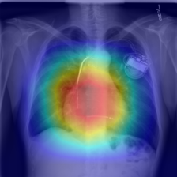
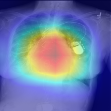
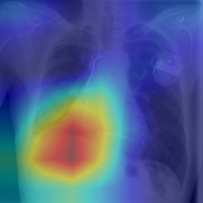
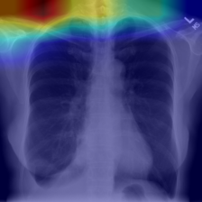
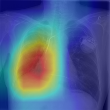
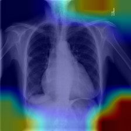

# Grad-CAM demo

**For education only, not for clinical use.** A Grad-CAM map shows which regions raised the
model's score for one label. It does not show where the finding is, and it is not a check that
the model is right.

- Model: DenseNet121, checkpoint `epoch_003.pt` (the best val epoch), run on CPU.
- Target layer: the last dense block (`features.denseblock4`).
- Preprocessing: the evaluation path (`resize_png`, then the test-split transform).
- Command: `python -m src.explain.gradcam --checkpoint epoch_003.pt --image <png> --label <label>
  --out-dir docs/figures/gradcam`.
- Each overlay is the 224px image the model saw: red is the highest Grad-CAM value and blue the
  lowest. Each JSON next to it holds the score, and the threshold and reliability from
  `configs/viewer_thresholds.yaml`.

## How the images were chosen

The rule was fixed before the model was run, so the choice does not depend on the scores. For
each finding, from the NIH ChestX-ray14 **test** split:

- PA view
- the finding is the image's only label
- sorted by image name; the first two images from different patients

The PNGs were downloaded one at a time with `kaggle datasets download nih-chest-xrays/data -f
<path>` into `data/raw/demo/` (gitignored). Labels are NLP-mined from reports, not verified by a
radiologist.

## Results

Scores are model outputs, not calibrated probabilities. All six labels use set B (val
sensitivity >= 0.80); none is flagged low reliability.

| image | label | score | threshold | above threshold | overlay |
|---|---|---|---|---|---|
| 00000013_045 | Cardiomegaly | 0.221 | 0.0248 | yes |  |
| 00000116_000 | Cardiomegaly | 0.734 | 0.0248 | yes |  |
| 00000013_021 | Effusion | 0.263 | 0.0805 | yes |  |
| 00000041_006 | Effusion | 0.057 | 0.0805 | no |  |
| 00000013_020 | Pneumothorax | 0.122 | 0.0199 | yes |  |
| 00000211_023 | Pneumothorax | 0.005 | 0.0199 | no |  |

What the maps show, from looking at these six:

- **Above the threshold (4 images):** the maps sit over the expected anatomy. The two
  Cardiomegaly maps are over the heart. The Effusion and Pneumothorax maps for patient 13 are
  over the right lower and mid hemithorax.
- **Below the threshold (2 images, missed positives):** the maps sit outside the lungs: the top
  edge and shoulders for 00000041_006, and a lower corner for 00000211_023.
- **Small sample:** these are 6 images from one rule. They show how the maps look, and say
  nothing about how often the model attends to the right region.
- **One patient, three images:** patient 13 provides 3 of the 6 images, and has a cardiac
  device. A map over the heart may partly reflect the device.
